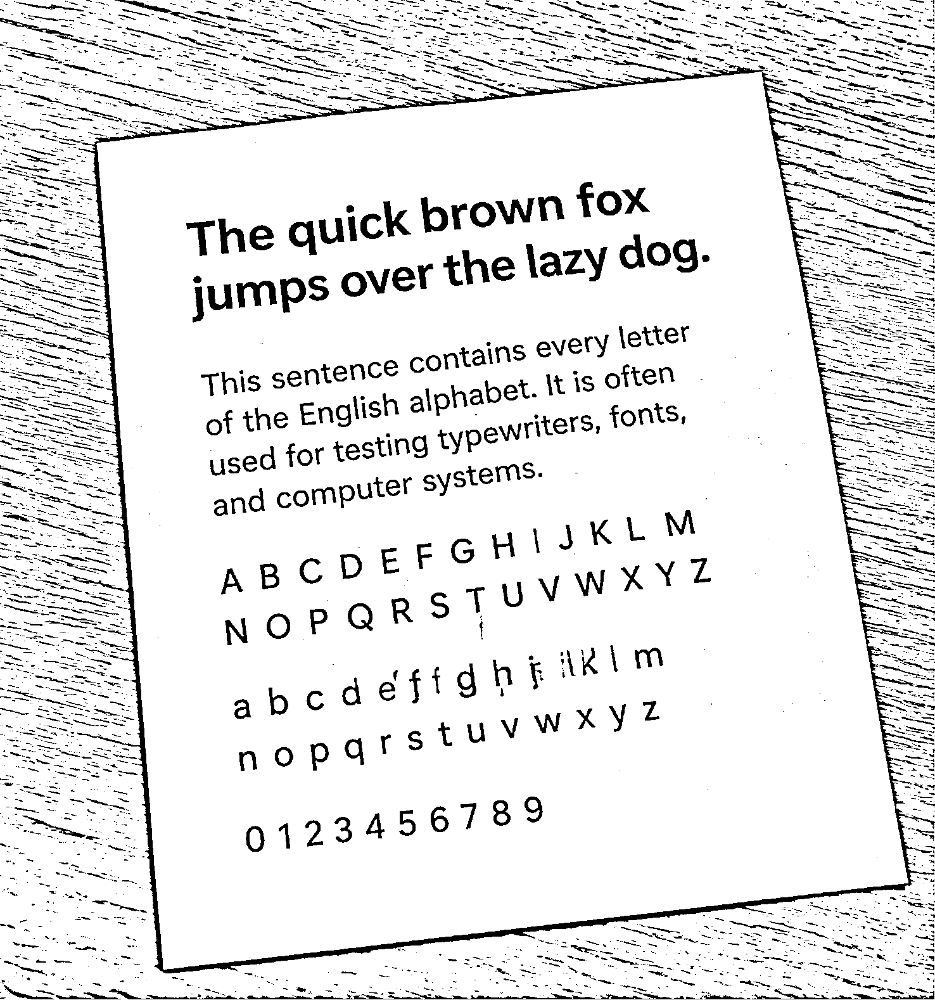
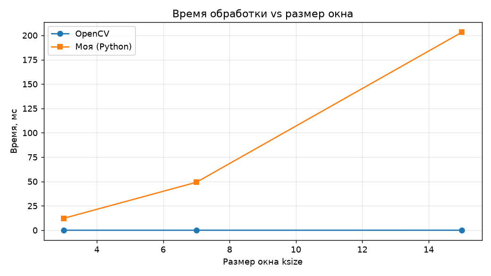

## 1 Теоретическая база

### Бинаризация изображения

Бинаризация — это преобразование изображения в оттенках серого в двухуровневое (чёрно-белое). Яркость каждого пикселя $I(x, y)$ сравнивается с порогом $T$:

$$
B(x, y) =
\begin{cases}
255, & I(x, y) > T \\
0, & \text{иначе}
\end{cases}
$$

Бинаризация используется для выделения объектов на фоне, например текста на бумаге, и является подготовительным этапом для распознавания символов, поиска контуров и сегментации.

### Глобальный порог

При глобальной бинаризации порог $T$ один для всего изображения. Его можно задать вручную (например, $T = 127$) или подобрать автоматически методом Оцу. Метод Оцу выбирает $T$ так, чтобы максимизировать межклассовую дисперсию яркости пикселей, отнесённых к фону и к объекту.

Недостаток глобального порога в том, что он не учитывает неоднородность изображения. При неравномерном освещении, тенях и градиентах яркости один и тот же порог не может одинаково хорошо работать на всех участках кадра: тёмные области целиком становятся чёрными, светлые целиком белыми, и часть деталей теряется.

### Адаптивный порог

В адаптивной бинаризации порог вычисляется **отдельно для каждого пикселя** по его локальной окрестности размером $k \times k$ (параметр `ksize`, нечётное число):

$$
T(x, y) = M(x, y) - C
$$

где:

- $M(x, y)$ — локальная оценка яркости в окне вокруг пикселя $(x, y)$;
- $C$ — константа смещения. Чем больше $C$, тем ниже порог, и тем меньше слабых колебаний яркости (шума, текстуры) превращается в чёрные пиксели.

Итоговое правило:

$$
B(x, y) =
\begin{cases}
255, & I(x, y) > M(x, y) - C \\
0, & \text{иначе}
\end{cases}
$$

Благодаря локальному порогу алгоритм устойчив к плавным изменениям освещённости: он реагирует не на абсолютную яркость пикселя, а на её отличие от яркости окрестности.

### Гауссово взвешивание (метод gaussian)

В варианте `gaussian` локальная яркость $M(x, y)$ — это взвешенная сумма пикселей окна, в которой веса убывают с расстоянием от центра по закону Гаусса. Центральные пиксели влияют на порог сильнее, чем краевые. Одномерные веса:

$$
g(i) = \frac{1}{Z}\exp\left(-\frac{i^2}{2\sigma^2}\right), \quad i = -\frac{k-1}{2}, \dots, \frac{k-1}{2}
$$

где $Z$ — нормировочный коэффициент, при котором $\sum_i g(i) = 1$, а $\sigma$ — среднеквадратичное отклонение, определяющее ширину «колокола». Если $\sigma$ не задана, используется формула, принятая в OpenCV:

$$
\sigma = 0.3\left(\frac{k-1}{2} - 1\right) + 0.8
$$

Локальная яркость определяется как свёртка изображения с двумерным ядром $G(i, j)$:

$$
M(x, y) = \sum_{i, j} G(i, j)\, I(x + i,\, y + j)
$$

По сравнению с равномерным усреднением (метод `mean`) гауссово взвешивание даёт более плавную оценку фона и меньше реагирует на резкие перепады на краю окна.

### Разделимость ядра Гаусса

Двумерное ядро Гаусса раскладывается в произведение двух одномерных:

$$
G(i, j) = g(i)\, g(j)
$$

Поэтому двумерная свёртка заменяется двумя последовательными одномерными: сначала по строкам, затем по столбцам. Число операций на один пиксель уменьшается с $k^2$ до $2k$. Это существенно ускоряет вычисления при больших размерах окна.

### Обработка границ изображения

У пикселей, расположенных у края изображения, окно частично выходит за его пределы. Недостающие значения достраиваются по одному из правил. В работе применяется *replicate*: значения крайних пикселей копируются наружу. Этот же способ используется в `cv2.adaptiveThreshold`, что позволяет сравнивать результаты напрямую.

### Особенность реализации в OpenCV

Для 8-битных изображений OpenCV округляет локальную яркость до целого числа, а затем сравнивает:

$$
I(x, y) - \operatorname{round}(M(x, y)) > -\lceil C \rceil
$$

Для совпадения результатов нативных реализаций с библиотечной это округление учитывается и в них.

### Вычислительная сложность

Время работы любой из реализаций линейно растёт с числом пикселей. Время версий на основе разделимой свёртки растёт линейно с размером окна, а версии с прямым перебором — квадратично.

## 2 Описание 

1. **`adaptive_opencv`** — готовая реализация: обёртка над `cv2.adaptiveThreshold`.
3. **`adaptive_python`** — собственная «наивная» реализация.

Параметры задаются в начале файла: ksize = 31 (размер окна), C = 10 (смещение порога), max_value = 255 (значение белого), crop_box.

**Принцип работы алгоритма**

Изображение читается сразу в оттенках серого, каждый пиксель число от 0 до 255.

Строится ядро Гаусса: набор весов, у которых центральный пиксель окна имеет наибольший вес, а края наименьший. Сумма весов равна 1.Для каждого пикселя считается локальная яркость - взвешенная сумма пикселей окна ksize × ksize вокруг него.
Порог равен локальной яркости (округлённой до целого) минус C.
Если пиксель ярче своего порога, он становится белым (255), иначе чёрным (0).

**Реализация на чистом Python**

версия без оптимизаций:

Для каждого пикселя изображения двумя вложенными циклами обходится всё окно k × k.
Каждый пиксель окна умножается на вес (произведение двух значений ядра), всё складывается.
Из суммы вычитается C, и результат сравнивается с яркостью пикселя.

## Результаты работы и тестирования системы (скриншоты, изображения, графики, закономерности)

### Картинка, с которой я работаю:

### Готовая реализация OpenCV 

На картинке я вижу, что адаптивный порог хорошо выделил весь текст на листе: заголовок, абзац, алфавит и цифры читаются чётко, а сама бумага осталась ровно белой, без пятен. Но на столе волокна дерева превратились в чёрно-белую штриховку, а по краю листа появилась тёмная рамка. Причина в том, что адаптивный порог реагирует на отличие пикселя от соседей, а у дерева такие отличия есть по всему столу. Для текста на листе это хорошо, для фона нет.

### Моя реализация на фрагменте

<table>
<tr>
<td></td>
<td></td>
<td></td>
</tr>
</table>

Адаптивная бинаризация по Гауссу позволяет отделить текст от фона, преобразуя изображение в чёрно-белое. При этом наблюдаются небольшие артефакты внутри букв и на их границах, связанные с локальным вычислением порога. Собственная реализация на Python дала идентичный результат с OpenCV на выбранном фрагменте (расхождение 0%)

### Размер окна

<table>
<tr>
<td></td>
<td></td>
</tr>
<tr>
<td></td>
<td></td>
</tr>
</table>

ksize = 7: заголовок получился пустым внутри, видны только контуры букв. Окно меньше толщины штриха, внутри буквы оно видит только тёмные пиксели, и середина становится белой. Мелкий текст при этом читается. Стол выглядит светлым и мелкозернистым, а край листа обозначен тонкой линией.

ksize = 15: заголовок уже закрашен, остальной текст чёткий. Стол остаётся достаточно светлым, но волокна проступают сильнее.

ksize = 31: текст чёткий и целый, бумага чисто белая. Волокна дерева стали контрастной штриховкой.

ksize = 101: текст по-прежнему читается, но вокруг листа появилась толстая чёрная кайма, а штриховка стола стала самой контрастной. Такое большое окно захватывает и светлый лист, и тёмный стол, средняя яркость у края получается промежуточной, и пиксели возле границы уходят в чёрное.

Вывод: окно должно быть больше толщины штриха букв (иначе буквы получаются пустыми), но не слишком большим (иначе возникает кайма у границ и теряется локальность порога). На этом изображении удобнее всего 15–31.

### Смещение порога

<table>
<tr>
<td></td>
<td></td>
</tr>
<tr>
<td></td>
<td></td>
</tr>
</table>

На картинках я вижу, что C в первую очередь управляет количеством шума на ровных областях.

C = 0: лист полностью покрыт тёмным шумом, текст почти тонет в нём. Порог равен среднему, поэтому любое случайное отклонение яркости на ровной бумаге превращается в чёрную точку.

C = 5: бумага стала в основном белой, но остались рассыпанные чёрные точки. Текст читается, шум ещё заметен.

C = 10: бумага чистая, текст чёткий. Шум остался только на столе в виде штриховки дерева.

C = 25: стол почти

Вывод: чем больше C, тем меньше шума превращается в чёрное. Малые значения оставляют мусор на однородных областях, большие убирают его, но при слишком большом C рискуют пропасть слабые и тонкие детали. На этом фото хорошо работают значения 10–25. Если нужно избавиться и от текстуры стола, лучше брать значения ближе к 25.

### Сравнение чистого Python и OpenCV на фрагменте 160×110

Для сравнения производительности чистой Python-реализации и OpenCV был выбран фрагмент изображения размером 160×110 пикселей. Тестирование проводилось при разных значениях размера окна `ksize`: 3, 7 и 15.

| `ksize` | Чистый Python, мс | OpenCV, мс | Python/OpenCV |
| ------: | ----------------: | ---------: | ------------: |
|       3 |            12.206 |      0.020 |        626,0× |
|       7 |            49.207 |      0.024 |       2093,9× |
|      15 |           203.168 |      0.033 |       6102,8× |
На небольшом фрагменте изображения чистая Python-реализация работает значительно медленнее OpenCV. При увеличении размера окна время её выполнения растёт особенно быстро: при `ksize = 3` обработка занимает 12,206 мс, а при `ksize = 15` — уже 203,168 мс.

OpenCV выполняет обработку значительно быстрее. При `ksize = 15` его скорость примерно в 6103 раза выше, чем у реализации на чистом Python.
Расхождение результатов бинаризации составило **0,0000 %**, полное совпадение результатов двух реализаций на проверенном фрагменте изображения.

### Источники к разделу

1. OpenCV Documentation. Image Thresholding. https://docs.opencv.org/4.x/d7/d4d/tutorial_py_thresholding.html
2. OpenCV Documentation. `cv::adaptiveThreshold`, `cv::getGaussianKernel`. https://docs.opencv.org/4.x/
3. Otsu N. A Threshold Selection Method from Gray-Level Histograms // IEEE Transactions on Systems, Man, and Cybernetics. 1979. Vol. 9, No. 1. P. 62–66.
4. Gonzalez R., Woods R. Digital Image Processing, 4th ed. Pearson, 2018.
