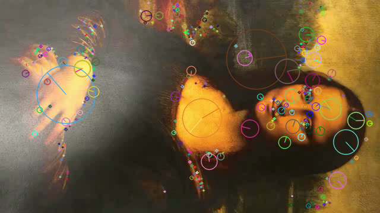
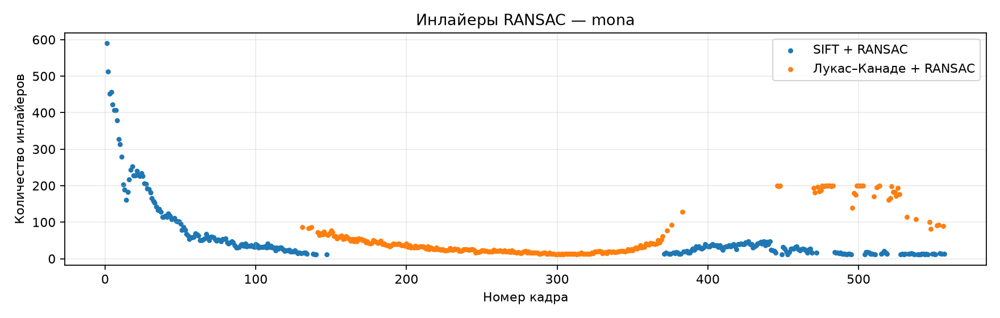
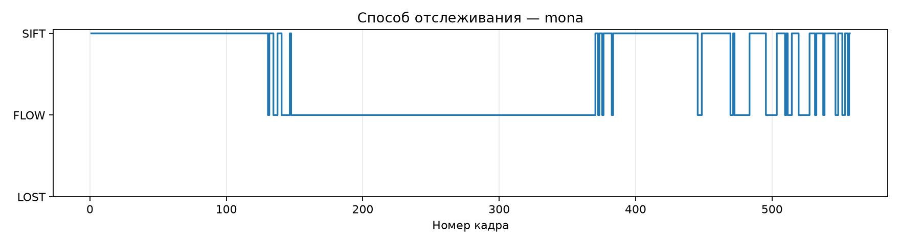
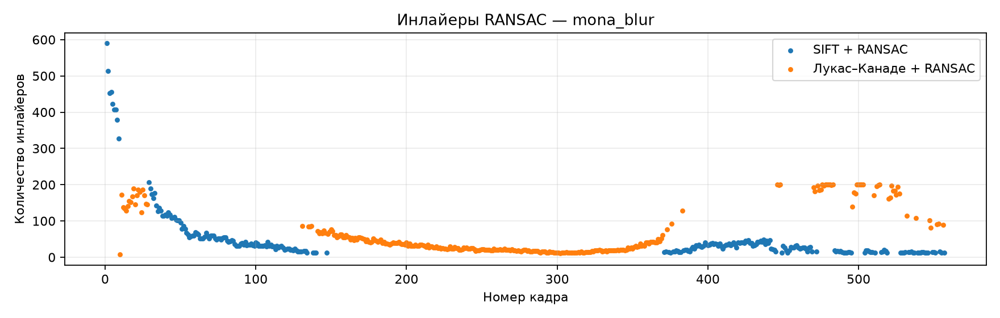
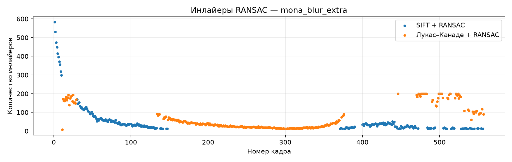
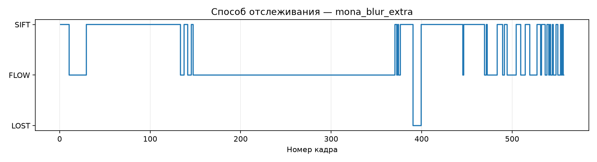
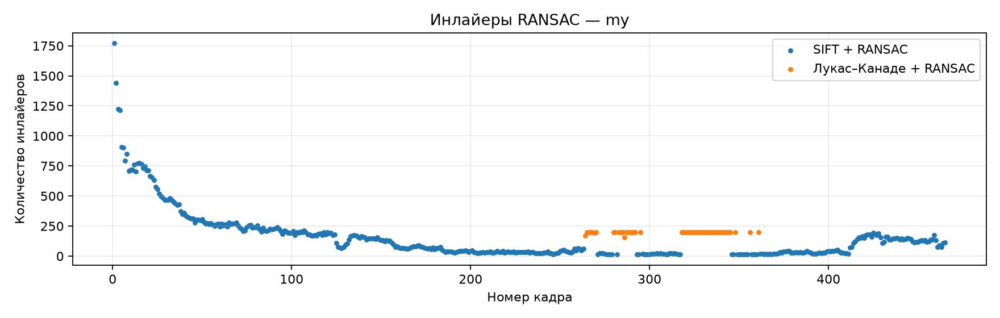
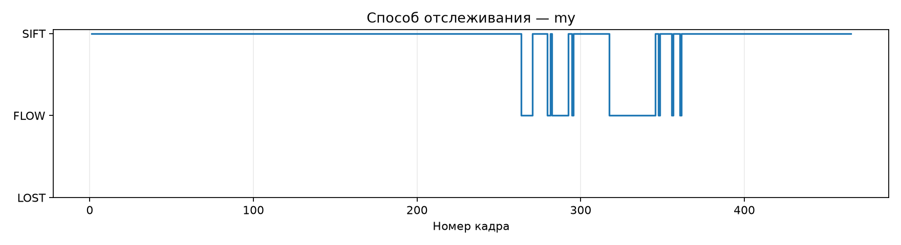

## Лабораторная работа номер 2: реализация алгоритма трекинга объекта на видео

### Теория

**Край** - это регион, при смещении в любом направлении которого нет изменений окрестности.

**Уголок** - это регион, в котором при смещении в любом направлении есть изменения окрестности: существуют детектор Харинсона и Стивенсона.

**Дискриптор** - это вектор признак окрестности точки, который идентифицирует точку.

**Метод Лукаса-Канаде** - заменяет поиск движения одной точки поиском движения целого локального «шаблона» (окна), что позволяет легко найти точный вектор смещения с помощью метода наименьших квадратов.

**Ключевая точка** — локальная особенность изображения (угол, пятно), которую можно
повторно найти на другом снимке той же сцены, несмотря на сдвиг, поворот, изменение
масштаба и освещения. Каждой точке сопоставляется *дескриптор* — вектор, описывающий её окрестность, похожие окрестности дают близкие дескрипторы.

* **SIFT** (Lowe, 2004). Точки ищутся как экстремумы разности гауссиан (DoG) в
  масштабном пространстве — это даёт инвариантность к масштабу. Ориентация точки
  берётся по доминирующему направлению градиента.

**Тест Лоу** (тест отношения расстояний, ratio test) — метод фильтрации сопоставлений ключевых точек,в рамках алгоритма SIFT. Для каждого дескриптора из одного изображения в другом изображении находятся два ближайших дескриптора в смысле евклидова расстояния (для бинарных дескрипторов — расстояния Хэмминга). Сопоставление принимается, только если расстояние до ближайшего соседа меньше расстояния до второго ближайшего, умноженного на пороговый коэффициент

**Оптический поток** - это картина видимого движения объектов на изображении между двумя последовательными кадрами, возникающая вследствие перемещения самих объектов или камеры. Он представляет собой двумерное векторное поле, в котором каждый вектор является вектором смещения, отражающим перемещение точек из первого кадра во второй.

$$
I(x, y, t) = I(x + dx,\; y + dy,\; t + dt)
$$

Разложим правую часть в ряд Тейлора до членов первого порядка:

$$
I(x + dx,\; y + dy,\; t + dt) \approx I(x, y, t) + \frac{\partial I}{\partial x}dx + \frac{\partial I}{\partial y}dy + \frac{\partial I}{\partial t}dt
$$

Сократим одинаковые члены и разделим на $dt$. Получим **уравнение оптического потока**:

$$
I_x u + I_y v + I_t = 0
$$

**Ошибка репроекции** — расстояние между фактическим положением ключевой точки на текущем кадре и её положением, предсказанным с помощью гомографии.

$$
e_i = \sqrt{(u_i-\hat{u}_i)^2+(v_i-\hat{v}_i)^2}
$$

**RANSAC (Random Sample Consensus)** — итерационный алгоритм оценки параметров математической модели по данным, содержащим ошибочные наблюдения (выбросы).

В данной работе RANSAC используется для вычисления **матрицы гомографии $H$** по соответствующим ключевым точкам двух изображений.

Алгоритм случайным образом выбирает четыре пары точек, вычисляет по ним гомографию и проверяет, насколько хорошо она описывает остальные соответствия. Точки, для которых ошибка репроекции не превышает заданный порог, называются **инлайерами (inliers)**, остальные — выбросами (outliers).

### Описание разработанной системы (алгоритмы, принципы работы, архитектура)

В основе реализации лежит поиск и сопоставление ключевых точек с помощью алгоритма **SIFT**, вычисление гомографии методом **RANSAC** и использование **оптического потока Лукаса Канаде** в качестве дополнительного механизма отслеживания.

Программа получает на вход видео, в котором первый кадр содержит изображение отслеживаемого объекта. На последующих кадрах она определяет положение объекта, выделяет его зелёной рамкой, отображает найденные ключевые точки и добавляет текстовую подпись.

#### 1. Подготовка эталонного изображения

На первом этапе программа считывает первый кадр видео, который используется в качестве эталонного изображения объекта.

Изображение переводится в оттенки серого с помощью `cv2.cvtColor()`, тк для поиска ключевых точек цветовая информация не требуется.

Далее для повышения устойчивости к изменению размера объекта задаю несколько масштабов эталона:

`scales = [1, 0.6, 0.4, 0.25, 0.15]`

На каждом масштабе с помощью `sift.detectAndCompute()` находятся ключевые точки и вычисляются их дескрипторы. Координаты точек пересчитываются в систему координат исходного изображения.

#### 2. Поиск объекта с помощью SIFT

Для каждого нового кадра выполняется поиск ключевых точек алгоритмом **SIFT (Scale-Invariant Feature Transform)**.

Алгоритм SIFT выделяет характерные участки изображения, например углы и границы, которые можно повторно обнаружить при изменении масштаба и повороте объекта.

После вычисления дескрипторов текущего кадра они сопоставляются с дескрипторами эталона с помощью `BFMatcher` и евклидова расстояния (`cv2.NORM_L2`).

Для фильтрации неправильных соответствий применяется **тест Лоу**. Для каждого дескриптора выбираются два ближайших соседа, после чего проверяется условие:

\[
d_1 < 0.8 \cdot d_2
\]

где \(d_1\) — расстояние до ближайшего соседа, а \(d_2\) — расстояние до второго ближайшего соседа.

Если условие выполняется, соответствие считается достаточно надёжным. Для дальнейшей обработки необходимо найти не менее 12 таких соответствий.

#### 3. Определение положения объекта с помощью RANSAC

После нахождения соответствующих ключевых точек программа вычисляет **матрицу гомографии** с помощью `cv2.findHomography()` и метода RANSAC.

В программе используется порог ошибки репроекции `4.0` пикселя. Результат принимается, если найдено не менее 12 инлайеров.

Поскольку эталон обрабатывается в нескольких масштабах, программа сравнивает полученные результаты и выбирает вариант с наибольшим числом инлайеров.

Далее с помощью `cv2.perspectiveTransform()` координаты углов эталонного изображения преобразуются в координаты текущего кадра. По этим точкам строится четырёхугольная рамка вокруг объекта.

#### 4. Отслеживание с помощью оптического потока

Если SIFT не смог определить положение объекта на текущем кадре, программа пытается использовать **оптический поток Лукаса — Канаде (Lucas–Kanade)**.

В реализации сначала с помощью `cv2.goodFeaturesToTrack()` выбирается до 200 характерных точек внутри рамки объекта на предыдущем кадре.

Затем функция `cv2.calcOpticalFlowPyrLK()` вычисляет предполагаемое положение этих точек на текущем кадре.

Если успешно отслежено не менее 8 точек, с помощью RANSAC вычисляется гомография между предыдущим и текущим кадрами. На её основе обновляется положение рамки.

#### 5. Архитектура программы

Программа состоит из трёх основных частей:

1. **Подготовка эталона:** считывание первого кадра, построение нескольких масштабов изображения, вычисление ключевых точек и дескрипторов SIFT.
2. **Поиск и отслеживание объекта:** функция `find_quad()` выполняет сопоставление дескрипторов и определение положения объекта с помощью RANSAC. Функция `follow()` реализует резервное отслеживание на основе оптического потока.
3. **Обработка и сохранение видео:** основной цикл последовательно обрабатывает кадры, вызывает необходимые алгоритмы, рисует рамку и точки, после чего записывает кадры в выходной файл.

Также программа подсчитывает количество кадров, на которых объект был обнаружен с помощью SIFT, найден с помощью оптического потока или не найден.

### Результаты работы и тестирования системы

Вначале я определила ключевые точки:

На эталонном кадре (первый кадр `mona-lisa.avi`) найдено 343 ключевые точки. Каждая из них описывается 128-мерным дескриптором. Точки расположены на контрастных элементах изображения (лицо, руки, границы света и тени) и практически отсутствуют на однородном фоне. Размер окружности соответствует масштабу точки, линия внутри окружности соответствует её ориентации.

#### Тестовые данные

Система была протестирована на четырёх видео:

| Видео | Кадров | Описание |
|---|---|---|
| `mona-lisa.avi` | 557 | исходное тестовое видео |
| `mona-lisa-blur.avi` | 557 | то же видео с добавленным смазом |
| `mona-lisa-blur-extra-credit.avi` | 557 | вариант видео со смазом (extra credit) |
| `my.MOV` | 465 | собственное видео (объект подписан «PAPER») |

Для каждого кадра фиксировался способ, которым было найдено положение объекта: детекция по ключевым точкам SIFT (с оценкой гомографии методом RANSAC).

#### Сводные результаты

| Видео | Кадров | Детекция SIFT | Оптический поток | Потеряно |
|---|---|---|---|---|
| `mona-lisa.avi` | 557 | 278 (49,9 %) | 279 (50,1 %) | 0 (0,0 %) |
| `mona-lisa-blur.avi` | 557 | 259 (46,5 %) | 298 (53,5 %) | 0 (0,0 %) |
| `mona-lisa-blur-extra-credit.avi` | 557 | 242 (43,4 %) | 306 (54,9 %) | 9 (1,6 %) |
| `my.MOV` | 465 | 414 (89,0 %) | 51 (11,0 %) | 0 (0,0 %) |

Суммарно на четырёх видео обработано 2136 кадров. Рамка построена на 2127 из них (99,6 %). Не найден объект только на 9 кадрах видео `mona-lisa-blur-extra-credit.avi`.

#### Видео `mona-lisa.avi`

Объект отслежен на всех кадрах. Детекция SIFT и оптический поток разделили видео почти поровну (49,9 % и 50,1 %).

Число инлайеров SIFT максимально в начале видео, когда объект крупный (около 590 на первых кадрах), и по мере удаления объекта убывает. К кадрам 130–150 оно приближается к порогу в 12 инлайеров, и дальше на участке примерно с 148 по 370 кадр объект ведётся оптическим потоком почти непрерывно. Число инлайеров потока на этом участке также снижается и минимально около кадров 280–320 (порядка 10–20), после чего растёт. Такой характер зависимости соответствует уменьшению видимого размера объекта в кадре и последующему увеличению. После кадра 370 детекция SIFT возобновляется (15–45 инлайеров). На последних кадрах (с 445 по 557) способы чередуются.

Горизонтальные «полки» на уровне 200 у инлайеров потока связаны с ограничением в 200 отслеживаемых точек, поэтому абсолютные значения для потока и для SIFT напрямую сравнивать нельзя.

#### Видео `mona-lisa-blur.avi`

Объект отслежен на всех кадрах. Доля детекции SIFT снизилась с 49,9 % до 46,5 % (с 278 до 259 кадров). Отличие от исходного видео наблюдается на начальном участке (примерно кадры 10–29): на чистом видео там SIFT даёт 200–300 инлайеров, а при смазе детекция не проходит порог, и положение объекта определяется оптическим потоком (120–190 инлайеров). После кадра 29 детекция SIFT восстанавливается, дальше график практически повторяет результат для исходного видео.

#### Видео `mona-lisa-blur-extra-credit.avi`

На этом видео получен единственный пропуск: 9 кадров (1,6 %) без рамки, примерно в диапазоне кадров 391–400. На этом участке не сработали ни детекция, ни оптический поток. Начиная с кадра около 400 детекция SIFT восстанавливается (около 35 инлайеров), и объект находится снова. Доля детекции уменьшилась до 43,4 % (242 кадра), оптический поток обработал 306 кадров (54,9 %). Начальный участок, как и в предыдущем видео, проходит на оптическом потоке.

#### Собственное видео `my.MOV`

Объект отслежен на всех 465 кадрах. Детекция SIFT справилась с 89,0 % кадров (414), оптический поток потребовался на 11,0 % (51 кадр). Число инлайеров в начале видео больше, чем на тестовых видео (около 1770 против 590), и остаётся выше 100 в течение первых 130 кадров. Затем оно убывает до 10–40 на участке примерно с 190 по 350 кадр. Оптический поток используется только на кадрах приблизительно с 264 по 362, и то фрагментами. На последних 50 кадрах число инлайеров снова растёт до 100–190.

#### Анализ результатов

1. **Полнота.** На трёх видео из четырёх рамка построена на 100 % кадров, на четвёртом на 98,4 %.
2. **Роль оптического потока.** Оптический поток обработал от 11 % (собственное видео) до 55 % кадров (видео со смазом). Он используется на кадрах, где число совпадений SIFT с эталоном падает ниже порога. Это происходит при уменьшении объекта в кадре и при смазе.
3. **Влияние смаза.** Добавление смаза уменьшает долю детекции SIFT: 49,9 % → 46,5 % → 43,4 %. Основная часть потерянной детекции компенсируется потоком. Пропуск в 9 кадров возник только на видео с наибольшим ухудшением.
4. **Зависимость от размера объекта.** На всех видео число инлайеров SIFT уменьшается при удалении объекта и растёт при приближении.
5. **Ограничения оценки.** Эталонная разметка рамки вручную не создавалась, поэтому в работе оценивались доля кадров, обработанных каждым способом, число инлайеров и визуальное совпадение рамки с объектом. Метрики точности положения рамки (например, IoU) не вычислялись.

### Выводы по работе

### Выводы

Тестирование проводилось на четырёх видеозаписях: исходном видео Mona Lisa, двух вариантах с размытием и собственном видео. Всего было обработано 2136 кадров, из которых на 2127 (99,6%) программа смогла построить рамку объекта.

По результатам тестирования можно сделать следующие выводы:

1. **Комбинирование SIFT и оптического потока позволяет уменьшить количество пропусков объекта.** На исходном видео Mona Lisa алгоритм SIFT обнаруживал объект на 49,9% кадров, а на оставшихся 50,1% использовался оптический поток. Но кстати говоря все таки был пропуск кадров у меня на на mona-blur-extra

2. **Размытие изображения снижает устойчивость обнаружения SIFT.** При переходе от исходного видео к вариантам с размытием доля кадров, обработанных SIFT, постепенно уменьшилась с 49,9% до 46,5% и 43,4%. Одновременно увеличилась доля использования оптического потока. На наиболее сложном видео было зафиксировано 9 кадров без обнаружения объекта, что составляет 1,6% от общего количества кадров этого видео.

3. **Изменение масштаба объекта влияет на количество согласованных ключевых точек.** На графиках наблюдается уменьшение количества инлайеров RANSAC при удалении объекта от камеры и их увеличение при приближении. При уменьшении числа надёжных соответствий SIFT чаще перестаёт удовлетворять условиям принятия гомографии, после чего система использует оптический поток.

4. **На собственном видео SIFT показал наибольшую долю успешных обнаружений.** Из 465 кадров объект был найден основным методом на 414 (89%), а оптический поток использовался только на 51 кадре (11%). Это показывает, что частота использования резервного метода существенно зависит от особенностей видеозаписи и отслеживаемого объекта.

5. **Количество инлайеров само по себе не гарантирует правильность положения рамки.** RANSAC позволяет отбрасывать ошибочные соответствия, однако полученная гомография может быть неточной даже при достаточном числе инлайеров. Поэтому в реализации дополнительно проверяется геометрическая корректность четырёхугольника.

6. **Разработанная система имеет ограничения.** Оптический поток зависит от положения объекта на предыдущем кадре, поэтому после полной потери отслеживания для восстановления рамки необходимо повторное обнаружение с помощью SIFT. **Кроме того, используемая гомография предполагает отслеживание плоского объекта или плоской поверхности**. PS у меня очень плохо почему то получалось делать это на книгах.

### Источники

1) https://docs.opencv.org/4.13.0/d4/dee/tutorial_optical_flow.html
2) Lucas, Bruce D., and Takeo Kanade. "An iterative image registration technique with an application to stereo vision." IJCAI'81: 7th international joint conference on Artificial intelligence. Vol. 2. 1981.
3) Fischler, Martin A., and Robert C. Bolles. "Random sample consensus: a paradigm for model fitting with applications to image analysis and automated cartography." Communications of the ACM 24.6 (1981): 381-395.
4) Shi, Jianbo. "Good features to track." 1994 Proceedings of IEEE conference on computer vision and pattern recognition. IEEE, 1994.
5) https://docs.opencv.org/4.13.0/da/df5/tutorial_py_sift_intro.html
6) https://docs.opencv.org/4.13.0/dc/dc3/tutorial_py_matcher.html
7) http://docs.opencv.org/4.13.0/d7/dff/tutorial_feature_homography.html